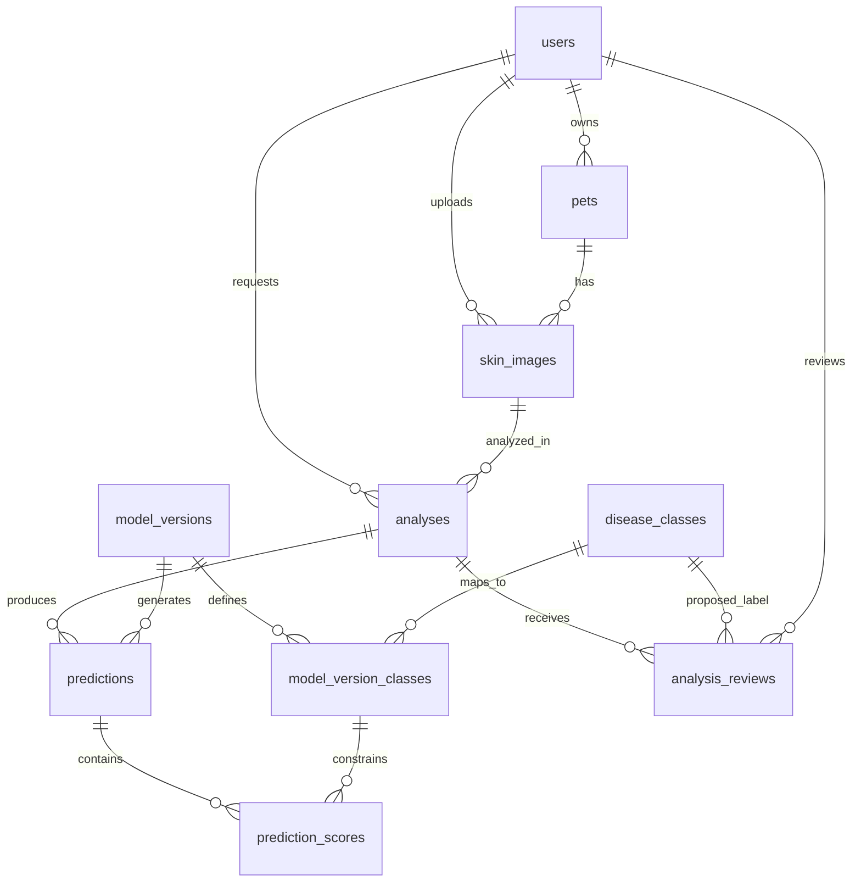

# แบบฐานข้อมูล PostgreSQL — Pet Health AI

## ขอบเขตและสิ่งที่พบในระบบ

ออกแบบจาก React และ FastAPI ในโปรเจกต์นี้ รองรับเจ้าของสุนัขหลายคน สุนัขหลายตัว การอัปโหลดภาพ ประวัติการวิเคราะห์ การเปรียบเทียบ MobileNetV3-Small กับ EfficientNet-B0 และการส่งข้อมูลแก้ไขผลวิเคราะห์

ปัจจุบัน `model/main.py` มี `/predict`, `/compare`, `/learn` แต่ยังไม่บันทึกประวัติลงฐานข้อมูล ส่วน `src/shared.jsx` ใช้ข้อมูลสุนัขและประวัติตัวอย่าง ยังไม่มีระบบบัญชีผู้ใช้จริง แบบนี้จึงสมมติว่าจะเพิ่มระบบสมาชิกและให้เจ้าของแต่ละคนเห็นข้อมูลสุนัขของตนเอง

**โมเดลมี 6 คลาส คือ 5 กลุ่มโรคและ healthy 1 คลาส** ใช้รหัสตาม `CLASSES_LIST` โดยตรง ไม่ใช้ชื่อภาษาอังกฤษที่จัดรูปแบบในหน้าเว็บเป็นรหัสอ้างอิง

ไฟล์ในโฟลเดอร์นี้เป็นแบบฐานข้อมูลและ SQL สำหรับสร้างตาราง ยังไม่ได้สร้างฐานข้อมูลบนเครื่องหรือเชื่อม API ให้ใช้งานจริง

## ภาพรวมตาราง

| ตาราง | หน้าที่ | ข้อมูลหลัก |
|---|---|---|
| `users` | บัญชีผู้ใช้และบทบาท | อีเมล, password hash, ชื่อ, owner/vet/admin |
| `pets` | ประวัติสุนัขและเจ้าของ | เจ้าของ, ชื่อ, สายพันธุ์, เพศ, วันเกิด |
| `disease_classes` | ข้อมูลคลาสที่โมเดลจำแนก | รหัสคลาส, ชื่อไทย/อังกฤษ, เป็น healthy หรือไม่ |
| `skin_images` | ข้อมูลภาพอัปโหลด | สุนัข, ผู้อัปโหลด, ที่เก็บภาพ, MIME, ขนาด, SHA-256, ตำแหน่งรอยโรค |
| `analyses` | การขอวิเคราะห์แต่ละครั้ง | ภาพ, ผู้ขอตรวจ, อาการ, สถานะ, ผลคัดกรองภาพ, เวลา |
| `model_versions` | ระบุโมเดลที่ใช้จริง | ชื่อ/รุ่น, ที่เก็บ weights, checksum, preprocessing, metrics |
| `model_version_classes` | จับคู่ลำดับ output ของโมเดลกับคลาส | รุ่นโมเดล, รหัสคลาส, output_index |
| `predictions` | ผลจากโมเดลแต่ละรุ่นในการตรวจหนึ่งครั้ง | การตรวจ, รุ่นโมเดล, ระยะเวลาประมวลผล, เลือกแสดงเป็นผลหลักหรือไม่ |
| `prediction_scores` | คะแนนครบทุกคลาสของแต่ละผล | ผลทำนาย, คลาส, คะแนน 0–1 |
| `analysis_reviews` | ข้อเสนอแก้ไขและผลตรวจทาน | การตรวจ, ผู้เสนอ, คลาสที่เสนอ, สถานะ, ผู้ยืนยัน |

ตารางหลักสำหรับงานบริการมี 9 ตาราง ส่วน `analysis_reviews` เพิ่มเพื่อเตรียมรับ feedback จาก `/learn` โดยไม่ปะปนคำตอบของผู้ใช้กับผลจากโมเดล

## ความสัมพันธ์ (ER diagram)



สุนัขหนึ่งตัวมีภาพหลายภาพ ภาพหนึ่งภาพวิเคราะห์ซ้ำได้หลายครั้ง และการวิเคราะห์ครั้งหนึ่งมีผลจากหลายโมเดลได้ ผลของแต่ละโมเดลมีคะแนน 6 แถวในระบบปัจจุบัน

`pet_id` ของการตรวจหาได้จาก `analyses.image_id → skin_images.pet_id` จึงไม่เก็บซ้ำใน `analyses` เพื่อลดปัญหาภาพกับสุนัขไม่ตรงกัน ส่วนรหัสโรคและคะแนนอันดับหนึ่งคำนวณจาก view `prediction_top_results` แทนการบันทึกซ้ำ

## รายละเอียดการออกแบบ

### ผู้ใช้และสุนัข

- Primary key ของข้อมูลธุรกรรมใช้ `bigint GENERATED ALWAYS AS IDENTITY`; รหัสคลาสใช้ `text` เป็น primary key เพื่อให้ตรงกับโมเดล
- อีเมลเก็บเป็นตัวพิมพ์เล็ก ตัดช่องว่าง และห้ามซ้ำ ฝั่ง API ต้องปรับรูปแบบก่อนบันทึก
- `password_hash` เก็บ hash ที่สร้างโดยระบบยืนยันตัวตน ห้ามเก็บรหัสผ่านจริง
- เก็บวันเกิดแทนอายุ เพื่อไม่ต้องแก้ข้อมูลทุกปี หากรู้เพียงอายุโดยประมาณ ให้ประมาณวันเกิดพร้อมตั้ง `birth_date_is_estimated = true` หากไม่ทราบให้เป็น NULL
- ใช้ `archived_at` เพื่อซ่อนสุนัขที่ไม่ใช้งานโดยยังรักษาประวัติเดิม ไม่เปิดให้เปลี่ยนเจ้าของในระยะแรก เพราะสิทธิ์ดูประวัติผูกกับเจ้าของปัจจุบัน

### รูปภาพ

- เก็บไฟล์ภาพในโฟลเดอร์ private uploads หรือ object storage ฐานข้อมูลเก็บ `storage_key` เช่น `skin-images/<random-id>.jpg` ไม่เก็บ binary หรือ Base64
- แยกชื่อไฟล์ต้นฉบับออกจากชื่อจัดเก็บ และให้ API สร้างชื่อใหม่
- `sha256` ช่วยหาภาพซ้ำและจัดกลุ่มชุดข้อมูล แต่ไม่ตั้ง UNIQUE เพราะอาจอัปโหลดภาพเดิมเพื่อตรวจซ้ำได้
- ขนาดสูงสุด 10 MiB และชนิดไฟล์ตรงกับหน้า Check ปัจจุบัน ฝั่ง API ต้องตรวจไฟล์จริงอีกครั้ง
- หนึ่งภาพผูกกับสุนัขหนึ่งตัว หากต้องรองรับผู้ใช้ที่ยังไม่สร้างโปรไฟล์ ควรออกแบบ guest workflow เพิ่มอย่างชัดเจน

### การตรวจและผลโมเดล

- `analyses.status`: `pending → processing → completed/rejected/failed` โดย API เป็นผู้ควบคุมลำดับสถานะ
- `rejected` ใช้กับภาพที่ไม่ผ่าน guardrail; `failed` ใช้กับข้อผิดพลาดการประมวลผล ส่วนไฟล์ที่อ่านไม่ได้ให้ปฏิเสธก่อนสร้าง `skin_images`
- เก็บ `guardrail_model_version` เป็นชื่อรุ่น/commit ของ CLIP พร้อมรุ่นกฎการคัดกรอง ไม่ใช่เพียงชื่อโมเดล
- `model_versions` ต้องลงทะเบียนจากไฟล์ weights จริง ไม่สร้างรุ่นตัวอย่างที่ดูเหมือนพร้อมใช้งาน และไม่แก้ไขแถวเดิมหรือทับไฟล์ weights ที่อ้างอิงเมื่อเทรนใหม่
- ลำดับเริ่มต้นใน `model_version_classes` คือ 0 bacterial_dermatosis, 1 demodicosis, 2 dermatitis, 3 fungal_infection, 4 healthy, 5 hypersensitivity ตามโค้ดปัจจุบัน
- เก็บค่าคะแนน 0–1 เช่น `0.87` แล้วคูณ 100 ตอนแสดงผล คะแนนนี้เป็นคะแนนโมเดล ไม่ใช่ความรุนแรงของโรค
- ไม่ย้ายค่า `risk` ปัจจุบันมาใช้เป็นระดับอาการโดยตรง เพราะหน้า Check คำนวณจาก confidence หากเพิ่มการประเมินความเร่งด่วนภายหลัง ให้แยกข้อมูลและระบุรุ่นกฎ
- หากใช้ `both` ให้สร้าง `predictions` สองแถว และเก็บคะแนน 6 แถวต่อโมเดล
- `is_selected` ระบุผลที่นำไปแสดงในประวัติ ใช้กฎเลือกโมเดลของ backend บันทึกไว้ในครั้งนั้น ไม่เลือกผลใหม่จากรุ่นปัจจุบันเมื่อเปิดดูประวัติ
- `metrics` เป็น JSONB สำหรับผลประเมินโมเดล เช่น macro F1 และรหัสชุดทดสอบ โดยผลคะแนนการตรวจจริงยังเก็บเป็นตารางปกติ

### Feedback และการเทรนต่อ

`analysis_reviews` เก็บข้อมูลที่ผู้ใช้เสนอแยกจากผลโมเดล เมื่อสัตวแพทย์หรือผู้ตรวจทานที่ได้รับสิทธิ์ยืนยันจึงเปลี่ยนเป็น `verified` ต้องมีผู้ยืนยันและเวลายืนยัน ข้อมูลเดิมควรเก็บไว้และเพิ่ม review ใหม่เมื่อมีการแก้ไข

เอกสาร roadmap เดิมเสนอให้นำผลที่สองโมเดลเห็นตรงกันไปเป็น verified data สำหรับแบบนี้ให้เก็บผลดังกล่าวเป็นผู้สมัครรอตรวจทาน เพราะโมเดลสองตัวอาจผิดตรงกันได้ ไม่ถือเป็น ground truth อัตโนมัติ

ยังไม่ต้องเพิ่มตารางเทรนในระยะฐานข้อมูลประวัติ เมื่อเริ่มทำ batch retraining ให้เพิ่ม:

| ตารางในอนาคต | ข้อมูลที่ควรมี |
|---|---|
| `dataset_versions` | รุ่นชุดข้อมูล, แหล่งที่มา/สิทธิ์ใช้งาน, วันที่สร้าง |
| `dataset_samples` | รุ่นชุดข้อมูล, ภาพ, review ที่รับรอง, label ณ เวลาสร้างชุด, split, group_key |
| `training_runs` | รุ่นชุดข้อมูล, โมเดลตั้งต้น, parameters, random seed, สถานะ, metrics, โมเดลผลลัพธ์ |
| `image_training_consents` | ภาพ, ผู้ให้ความยินยอม, รุ่นข้อความยินยอม, วันที่ให้/ถอน |

ไม่ใช้ `is_trained` เพียงค่าเดียว เพราะภาพเดียวอาจอยู่ในหลายรอบการเทรน ต้องย้อนดูได้ว่าโมเดลรุ่นใดใช้ข้อมูลชุดไหน แยก train/validation/test ตามสุนัขหรือเคส และรวมภาพซ้ำ/ใกล้เคียงไว้ในกลุ่มเดียวเพื่อป้องกันข้อมูลรั่วข้าม split ตรวจสิทธิ์ใช้ภาพและความยินยอมก่อนส่งเข้าชุดข้อมูล

## สิ่งที่ฐานข้อมูลบังคับ และสิ่งที่ API ต้องบังคับ

SQL มี foreign keys, unique constraints, ช่วงคะแนน, ชนิดสถานะ, ขนาดไฟล์ และดัชนีสำหรับค้นประวัติ รวมทั้ง composite foreign keys ที่ป้องกันคะแนนอ้างคลาสหรือรุ่นโมเดลผิดกัน

ข้อกำหนดข้ามแถว/สิทธิ์ต่อไปนี้ให้ทำใน service ของ FastAPI ภายใน transaction (ยังไม่ได้เขียน service ในงานนี้):

1. ผู้ใช้เข้าถึงเฉพาะสุนัข ภาพ ประวัติ และ feedback ที่ตนมีสิทธิ์; ห้ามเชื่อ `owner_id` หรือ `requested_by` ที่ส่งจากหน้าเว็บ ต้องอ่านจากบัญชีที่ยืนยันตัวตน
2. ควบคุมการตั้ง role และให้เฉพาะผู้มีสิทธิ์ยืนยัน review; SQL ไม่ได้ตรวจ role ของ `verified_by` อัตโนมัติ
3. วันเกิดต้องไม่อยู่ในอนาคต และวันถ่ายภาพต้องสมเหตุสมผล
4. ก่อนปิดสถานะ completed ตรวจว่าทุกรุ่นมี mapping 6 คลาสครบ คะแนนครบและผลรวมใกล้ 1 (`abs(sum - 1) <= 0.001` รองรับการปัด 4 ตำแหน่งใน API ปัจจุบัน) มีผลหลักหนึ่งรายการ และรุ่นที่เลือกผ่านการ fine-tune สำหรับคลาสเหล่านี้แล้ว
5. บันทึก predictions, scores และเปลี่ยนสถานะ completed ใน transaction เดียว โดยล็อก analysis ที่กำลังปิดผล ป้องกันคำขอพร้อมกัน แล้วห้ามแก้ผลที่เสร็จแล้ว ให้วิเคราะห์ครั้งใหม่แทน
6. เก็บไฟล์ภาพก่อน commit แถวภาพ และลบไฟล์ชั่วคราวหาก transaction ล้มเหลว; สำรองฐานข้อมูลและไฟล์ประกอบคู่กัน

partial unique index บังคับได้ว่าแต่ละ analysis มี `is_selected = true` **ไม่เกินหนึ่งรายการ** ส่วนข้อกำหนดว่าต้องมีหนึ่งรายการและคะแนนต้องครบทุกคลาสต้องตรวจเพิ่มใน API ไม่ได้ถูกบังคับโดย schema นี้

ใช้ `ON DELETE RESTRICT` เพื่อไม่ลบประวัติที่ถูกอ้างอิงโดยไม่ตั้งใจ หากจะลบบัญชี/ข้อมูลจริงให้ทำขั้นตอนลบหรือทำข้อมูลไม่ระบุตัวตน พร้อมจัดการไฟล์ภาพตามนโยบาย ไม่ใช่ลบเพียงแถวผู้ใช้

## การสร้างฐานข้อมูล

ต้องมี PostgreSQL และ `psql` อยู่ก่อน คำสั่งตัวอย่างให้ใส่บัญชีที่ใช้จริง ไม่ฝังรหัสผ่านในไฟล์โปรเจกต์:

```powershell
createdb -U postgres -E UTF8 pet_health_ai
psql -U postgres -d pet_health_ai -v ON_ERROR_STOP=1 -f database/001_initial_schema.sql
psql -U postgres -d pet_health_ai -v ON_ERROR_STOP=1 -f database/002_seed_classes.sql
```

`001` ใช้กับฐานข้อมูลว่างและรันครั้งเดียว หากเปลี่ยนโครงสร้างให้สร้าง migration ถัดไป ส่วน `002` รันซ้ำได้โดยไม่เพิ่มคลาสซ้ำ เก็บข้อมูลวันเวลาเป็น `timestamptz` และให้ frontend แสดงใน Asia/Bangkok

## ตัวอย่างดึงประวัติสำหรับหน้า History

ตัวอย่างสำหรับ Python DB driver ที่รองรับ named parameters ให้ส่ง `owner_id` จาก session ที่ตรวจสอบแล้ว และผูกค่าผ่าน parameters:

```sql
SELECT a.id, p.id AS pet_id, p.name AS pet_name,
       a.created_at, a.status,
       c.code AS class_code, c.name_th, t.score,
       m.model_name, m.version
FROM analyses a
JOIN skin_images i ON i.id = a.image_id
JOIN pets p ON p.id = i.pet_id
LEFT JOIN prediction_top_results t ON t.analysis_id = a.id AND t.is_selected
LEFT JOIN disease_classes c ON c.code = t.class_code
LEFT JOIN model_versions m ON m.id = t.model_version_id
WHERE p.owner_id = %(owner_id)s
ORDER BY a.created_at DESC, a.id DESC
LIMIT %(limit)s OFFSET %(offset)s;
```

ผลจาก rejected/failed ยังคงอยู่ในประวัติ โดย class/score เป็น NULL ตามจริง และไม่ตีความว่าเป็น healthy

## ขั้นตอนเชื่อมกับโค้ดในงานถัดไป

1. เพิ่มการเชื่อมต่อ PostgreSQL และ migrations ใน FastAPI พร้อมระบบยืนยันตัวตน
2. เพิ่ม API จัดการสุนัขและดึงคลาส แทนค่าคงที่ `PETS` ใน frontend
3. `/predict` รับ pet_id ตรวจเจ้าของ จัดเก็บภาพ สร้าง analysis และบันทึกผลแต่ละโมเดลตาม transaction ข้างต้น
4. เพิ่ม API ดึงประวัติ แทน `HISTORY` ตัวอย่าง และใช้ class_code เป็นรหัสกลางระหว่าง frontend/backend
5. ปรับ `/learn` ให้รับ feedback เข้าคิวตรวจทานก่อน แยกการเทรนเป็นงาน batch และสร้าง model version ใหม่
6. เพิ่มตารางชุดข้อมูล/งานเทรนเมื่อเริ่มทำ retraining ที่ติดตามย้อนหลังได้

คลินิก/การนัดหมายยังแยกเป็นส่วนขยายได้ เพราะไม่จำเป็นต่อการอัปโหลดภาพและเก็บผล ML ในระยะแรก

อ้างอิงกฎ PostgreSQL: [Constraints](https://www.postgresql.org/docs/current/ddl-constraints.html) โดยเฉพาะ foreign keys, unique constraints และข้อจำกัดของ CHECK ที่ไม่ควรนำไปตรวจข้อมูลข้ามแถว
